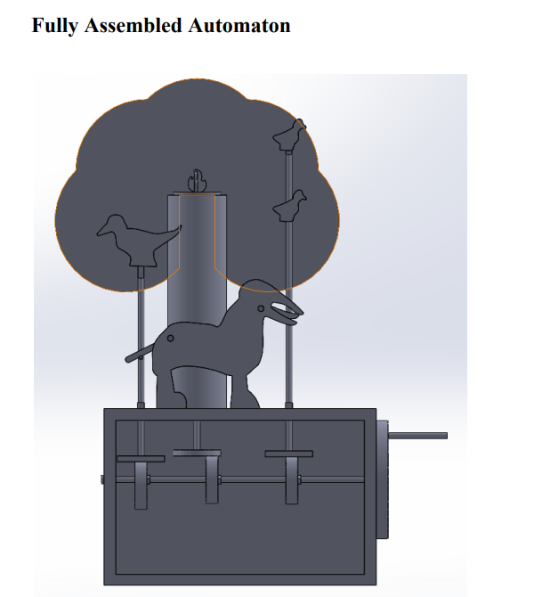

# Chaotika Automaton (Solidworks)

A hand-cranked mechanical automaton: a dog barks and wags its tail at a burning tree while a predator bird and two prey birds bob in the chaos. Designed and built for **ENGR 1025U – Engineering Design (Summer 2025)** at Ontario Tech University.

Everything is driven by one hand crank, a shaft, and a few cams and followers. No gears, no electronics.



## How it works

A single rotating axle (Ø5 mm) carries the cams. Each cam pushes a follower, and each follower drives something in the scene.

| Cam | Drives | Motion |
|---|---|---|
| Cam for Tail and Tongue (x2, Ø40 mm, 5 mm eccentric) | Dog tail, dog tongue | Follower rises and falls; copper-wire linkage turns it into a swinging tail and a barking tongue |
| Follower rods | Two prey birds, predator bird | Birds ride the vertical follower rods and bob up and down |
| Tree Cam (Ø40 mm) | Fire | Perpendicular friction drive spins the flame on top of the tree (used instead of bevel gears to keep it simple for kids) |

Design targets: at least 5 independently moving parts (the prototype has 6), with at least 3 dependent on each other, safe for children aged 4–12, hand-operated.

## Parts list (from the SolidWorks assembly)

| # | Part | Qty |
|---|---|---|
| 1 | Tree | 1 |
| 2 | Fire | 1 |
| 3 | Dog Hinge Cover | 2 |
| 4 | Prey Bird | 2 |
| 5 | Dog Tongue | 1 |
| 6 | Cam Follower and Rod for Tongue | 1 |
| 7 | Rotating Axle | 1 |
| 8 | Tree Cam | 1 |
| 9 | Automata Shell | 1 |
| 10 | Cam for Tail and Tongue | 2 |
| 11 | Rotating Axle Cover | 1 |
| 12 | Cam Follower and Rod for Fire | 1 |
| 13 | Dog Tail | 1 |
| 14 | Cam Follower and Rod for Tail | 1 |
| 15 | Dog Hinge Pin | 2 |
| 16 | Predator Bird | 1 |
| 17 | Dog Body | 1 |

Bill of materials with suppliers and part numbers: [`bom/bill_of_materials.csv`](bom/bill_of_materials.csv)

## Repository layout

```
cad/
  parts/        SolidWorks part files (.SLDPRT)
  assembly/     Full assembly + exploded view (.SLDASM)
drawings/       Engineering drawings (.SLDDRW / PDF export)
sketches/       Hand-drawn concept sketches (options 1-3, subassemblies)
bom/            Bill of materials (CSV)
docs/           Test plan, design process notes
images/         Photos / renders for this README
```

Drawing units are millimetres. General tolerances: linear ±0.01, angular ±0.5°.

## Design process

1. **Concepts** – three options sketched and voted on: lumberjack, car jack, and the fire-scene automaton. The lumberjack was too complex and had a pinch hazard; the car jack was monotonous and did not meet the moving-parts requirement. The fire scene won unanimously. See [`docs/design-process.md`](docs/design-process.md).
2. **CAD** – every part modelled in SolidWorks and assembled to check motion and clearances.
3. **Prototype** – built from the drawings, then tuned for cam alignment and follower friction.
4. **Testing** – visual, motion, durability (100 crank turns), child safety, and motion-timing checklists. The final prototype passed all of them. See [`docs/test-plan.md`](docs/test-plan.md).

## Team

ENGR 1025U, Summer 2025. Instructor: Naglaa Elagamy, PhD, P.Eng.

- **Omar Islam** – SolidWorks modelling, engineering drawings, concept sketches
- Mahmoud Ahmed
- Rania Al-Dilaimi
- Syed Sharib Hashmi

## License

Course project, shared for reference. Add a license file (for example MIT for docs, CC BY 4.0 for CAD and drawings) before inviting reuse.
